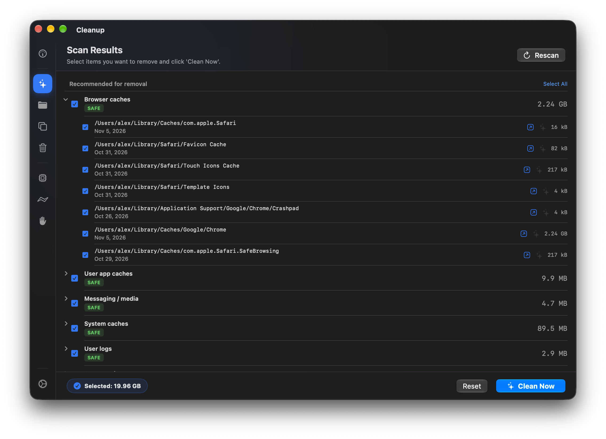
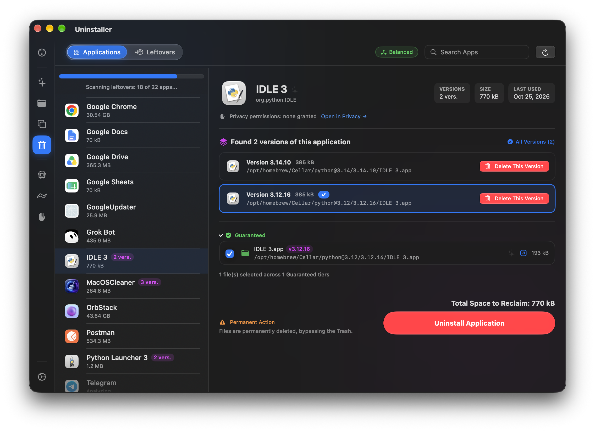

<div align="center">
  <h1 align="center">
    <br>
    <b style="font-size: 2rem">MacOS Cleaner</b>
  </h1>
  <p>
    Free, native, privacy-first cleaner and application uninstaller for macOS.<br>
    Built with Swift 6 and SwiftUI. Review everything before cleaning. Uninstalls and duplicates go to Trash.
  </p>

  <p>
    <small>Requirements: macOS 26.0 or later. Apple Silicon only (Intel Macs are not supported).</small>
  </p>

  <p>
    <a href="https://github.com/AlexTkDev/MacOSCleaner/releases/latest"></a>
    &nbsp;
    <a href="https://alextkdev.github.io/MacOSCleaner/"></a> &nbsp; <a href="https://github.com/AlexTkDev/MacOSCleaner"></a>
  </p>

  <p>
    <a href="https://github.com/AlexTkDev/MacOSCleaner/releases/tag/3.0.0"></a>
    <a href="https://apple.com"></a>
    <a href="https://swift.org"></a>
    <a href="https://developer.apple.com/xcode/swiftui/"></a>
    
    <a href="LICENSE"></a>
  </p>

  <p>
    <a href="#features">✨ Features</a> &nbsp;•&nbsp;
    <a href="#demo">🎬 Demo</a> &nbsp;•&nbsp;
    <a href="#build-from-source">🛠️ Build from Source</a> &nbsp;•&nbsp;
    <!-- <a href="#community">🗺️ Roadmap</a> &nbsp;•&nbsp; -->
    <a href="https://github.com/AlexTkDev/MacOSCleaner/wiki">📖 Documentation</a>
  </p>
</div>

> [!IMPORTANT]
> **MacOSCleaner 3.0.1 is coming in the next few days** with fixes and improvements based on user feedback (see [#39](https://github.com/AlexTkDev/MacOSCleaner/issues/39)). The developer recommends waiting for 3.0.1 before installing or updating.

---

<a id="safety"></a>
## 🛡️ Safety and Architecture

| Principle | Technical Implementation |
| :--- | :--- |
| **No Telemetry** | No background daemons, analytics SDKs, or remote loggers. All scanning runs locally without network access. |
| **Safe Deletion** | Cleanup, App Uninstaller, Disk Space Analyzer, Duplicate Finder, and Startup Services move files to macOS Trash via `trashItem(at:)` by default for recoverable deletion. Permanent removal (`removeItem(at:)`) is strictly opt-in. |
| **Protected Paths** | Hardcoded blocklists protect SIP paths, `/System`, `/Library`, `/usr`, `~/.ssh`, user documents, credential files (`.env`, `.npmrc`, `.yarnrc`, `.pypirc`), IDE settings (`.vscode`, `.idea`, `.zed`), and Finder sidebar favorites (`FavoriteItems.sfl3` / `.sfl4`). |
| **Non-Destructive Scanning** | Scanning never terminates running applications or modifies files. Cleanup and uninstallation enforce a 3-second soft quit timeout before forced termination. |
| **Open Core** | Swift 6 codebase with strict concurrency, actors, and structured task groups. Core engine and heuristics are inspectable. |
| **On-Device AI** | Checksums, hashes, and `FoundationModels` file explanations execute strictly on-device without cloud relays (no Private Cloud Compute or third-party APIs). |
| **Native Runtime** | Built in Swift 6 and SwiftUI with Liquid Glass materials. No Electron or WebKit container overhead. |

---

<a id="demo"></a>
## 🎬 Demo & Screenshots

<p align="center">
  <a href="assets/demo_video_v3.mp4">
    
  </a>
  <a href="assets/demo_video_v3.mp4">
    
  </a>
</p>

<p align="center">
  
  
</p>
<p align="center">
  
  
</p>

<p align="center">
  <a href="assets/screenshots">View high-resolution screenshots</a>
</p>

---

## 🚀 Quick Download & Install

1. **Direct Download:** Grab the latest `.dmg` from [GitHub Releases](https://github.com/AlexTkDev/MacOSCleaner/releases/latest).
2. **Mount & Drag:** Open the `.dmg` and drag `MacOSCleaner.app` into `/Applications`.
3. **If macOS says it can't verify MacOSCleaner:** On macOS 26, Gatekeeper can block the first open (“Apple could not verify “MacOSCleaner” is free of malware”, or a dialog that it cannot verify the app is free of malware) because the app is ad-hoc signed. Only do this with the DMG from the official [GitHub Releases](https://github.com/AlexTkDev/MacOSCleaner/releases/latest) page.
   1. Move `MacOSCleaner.app` to `/Applications` (step 2).
   2. Try to open it once. Then go to **System Settings → Privacy & Security**, scroll down, click **Open Anyway**, and confirm.
   3. Or, in Terminal:

      ```bash
      xattr -dr com.apple.quarantine /Applications/MacOSCleaner.app
      ```

      > *This clears the quarantine flag macOS sets on that download. It does not change the app or system security.*

---

<a id="features"></a>
## ✨ Features

- **Smart Cleanup:** scans 55+ categories across system caches, user logs, browser data, 305 applications, and 105 developer toolchains (Xcode, Docker, `uv`, `mise`, Rust, Go `modcache`, Python, Node, CocoaPods), aged project-local build artifacts (verified by sibling project markers), forgotten installer images (`.dmg`, `.pkg`, `.iso`, and `.zip` central-directory inspection without mounting), local AI models (Claude Code, Ollama, MLX, Hugging Face, WhisperKit), and safe Time Machine snapshot thinning (`thinlocalsnapshots`). Includes review-only categories deselected by default, guarded Font Cache reset with confirmation, APFS reclaimable space delta, adaptive debug log panel, and a dedicated History window (`⌘Y`).
- **Forensic Uninstaller:** inspects 30 evidence types (Bundle ID, Team ID, Spotlight metadata, Launch Services) across 2,427 cataloged remnant paths. Features a 3-stage uninstallation pipeline (soft quit → `launchd` helper bootout → file trashing), automatic Dock icon cleanup (`com.apple.dock`) with multi-version protection, inline TCC privacy permission chips on app cards, word-boundary matching to prevent false positives, Intel-only app badges (`executableArchitectures`), and standalone orphaned residuals cleanup with privilege escalation fallback.
- **Duplicate Finder:** Master-Detail split interface (`HSplitView`) with side-by-side group and file inspection. 3-stage detection pipeline (file size matching, 4 KB header checksum, full SHA-256 verification), native Quick Look previews (`Space`), high-resolution photo previews, middle-truncation path formatting, and Smart Selection actions (`Select All Duplicates`, `Deselect All`).
- **Disk Space Analyzer:** hierarchical folder drill-down with breadcrumb navigation, honest APFS allocated block sizing (`totalFileAllocatedSizeKey`), symlink skipping and hardlink inode deduplication, Quick Look previews (`Space`), recursive category filters (Videos, Audio, Photos, Apps, Documents, Archives — excluding `.framework`/`.dSYM`/document bundles from Apps), and dataless iCloud item skip protection.
- **Process and Service Manager:** monitors live CPU and RAM usage with termination safeguards for critical system processes (`kernel_task`, `launchd`), chunked lazy loading (`LazyVStack`), and configurable refresh/sort settings. Startup Services manager categorizes LaunchAgents, LaunchDaemons, and BTM Login Items (`sfltool dumpbtm`), verifies `SecStaticCode` signatures and notarization (`Needs Attention` filter), supports disabling/enabling user agents and background monitors (`launchctl disable`/`bootout` + process termination), and offers direct "Show in Finder" and safe service removal.
- **Privacy Inspector:** inspects user and system TCC permissions (read-only SQLite URI `?mode=ro&immutable=1`) with verified user-permission reset via `tccutil reset`, captures on-demand active socket snapshots via `libproc` (`proc_pidfdinfo`) for current-UID processes alongside static `Info.plist` network indicators, and lists Safari, Chrome, Edge, Brave, Arc, and Firefox extensions with localized name resolution, permission risk classification, and direct extension-page navigation (via Automation script for Chromium browsers, with clipboard fallback).
- **Native System Integrations & Apple Intelligence:** on-device `FoundationModels` structured classification (`@Generable` verdicts: safe, caution, danger) with streaming explanations, Apple Intelligence storage overview in Settings, Siri and App Intents automation (`CleanCategoryIntent`, `CleanDeveloperCachesIntent`, `EmptyTrashIntent`, `RunScheduledCleanupIntent`) with `.requiresAuthentication`, compact `48pt` Liquid Glass navigation rail (`GlassEffectContainer`, `glassEffectUnion`), full keyboard shortcuts (`⌘1`–`⌘9`, `⌘Y`, `⌘,`, `⌘C`, `⌘F`, `⌘R`, `⌘⌫`), and 14 language localizations (English, Russian, Ukrainian, German, French, Spanish, Italian, Japanese, Simplified & Traditional Chinese, Korean, Polish, Brazilian Portuguese, and Arabic with native RTL layout).

Complete feature breakdowns and path specifications are documented in the [MacOSCleaner Wiki](https://github.com/AlexTkDev/MacOSCleaner/wiki).

---

<a id="build-from-source"></a>
## 🛠️ Build from Source

**Prerequisites:** macOS 26.0+, Xcode 26+, [XcodeGen](https://github.com/yonaskolb/XcodeGen).

```bash
git clone https://github.com/AlexTkDev/MacOSCleaner.git
cd MacOSCleaner/MacOSCleaner
xcodegen
open MacOSCleaner.xcodeproj
```

Build and run with **⌘R**, or run tests with **⌘U**.

### Verify Release Checksums & Signature

Compare the downloaded `.dmg` checksum against the SHA-256 value published on [GitHub Releases](https://github.com/AlexTkDev/MacOSCleaner/releases):

```bash
shasum -a 256 MacOSCleaner-*.dmg
codesign -dv --verbose=4 /Applications/MacOSCleaner.app
```

## ⚠️ Known Limitations

- **Not an Antivirus:** Startup Services checks inspect code signatures, binary presence, and launch paths — they do not use malware signatures and cannot guarantee software is safe.
- **TCC Permissions:** Without Full Disk Access, user `TCC.db` shows "no data"; system `TCC.db` is protected by SIP and read-only. Resetting a permission via `tccutil reset` clears the decision so the app prompts again on next use (it does not permanently block future prompts).
- **Network Snapshot (`EPERM`):** Non-root inspection via `proc_pidfdinfo` only sees sockets of processes owned by the current user (`UID`). System/root daemons are explicitly marked as restricted (`EPERM`).
- **Browser Extensions:** Read-only inspection only. Clicking an extension opens the corresponding browser's management page (Chromium browsers use an Automation script to open the specific extension tab and fall back to copying the URL if Automation permission is denied) so you can disable or remove it using the browser's built-in controls.
- **On-Demand Only:** No background daemon, continuous network monitor, or packet capture runs in the background.

---

<a id="community"></a>
## ⭐️ Support & Community

If you find MacOS Cleaner useful, please consider giving it a ⭐️ on GitHub. It helps more users discover the project and directly supports ongoing development.

- <a href="https://github.com/AlexTkDev/MacOSCleaner/stargazers"></a> — [Star the repository](https://github.com/AlexTkDev/MacOSCleaner/stargazers) and watch releases for update notifications.
- <a href="https://github.com/AlexTkDev/MacOSCleaner/discussions"></a> — [Ask questions, propose features, and share feedback.](https://github.com/AlexTkDev/MacOSCleaner/discussions)
- <a href="https://github.com/AlexTkDev/MacOSCleaner/issues"></a> — [Report bugs or suggest rule improvements.](https://github.com/AlexTkDev/MacOSCleaner/issues)
- <a href="https://github.com/AlexTkDev/MacOSCleaner/wiki"></a> — [Architecture overview and developer guides.](https://github.com/AlexTkDev/MacOSCleaner/wiki)
- <a href="https://cursor.com/codebase/alextkdev/MacOSCleaner/tree/release"></a> — [Explore repository online and open in Cursor.](https://cursor.com/codebase/alextkdev/MacOSCleaner/tree/release)

### Our Partners
<p>
<a href="https://alternativeto.net/software/macoscleaner/about/?utm_source=badge&utm_medium=referral"></a>
<a href="https://www.saashub.com/macoscleaner?utm_source=badge&utm_campaign=badge&utm_content=macoscleaner&badge_variant=color&badge_kind=approved"></a>
<a href="https://macnative.io/apps/macoscleaner?utm_source=macnative-badge&utm_medium=referral"></a>
<a href="https://macappindex.com/apps/macos-cleaner?ref=badge" target="_blank" title="MacOS Cleaner on Mac App Index"></a>
<a href="https://macbrowse.com"></a>
<a href="https://alextkdev.github.io/MacOSCleaner/#footer-partners-heading" title="All MacOS Cleaner partners"></a>
</p>

> *Note: Contributions are subject to the project's [Contributor License Agreement (CLA)](CLA.md).*

---

## 👨‍💻 Author

<table>
  <tr>
    <td width="72" align="center" valign="middle">
      <a href="https://github.com/AlexTkDev">
        
      </a>
    </td>
    <td>
      <strong>Aleksandr (AlexTkDev)</strong><br>
      <a href="https://github.com/AlexTkDev"></a>
      <a href="https://orcid.org/0009-0002-8907-5406"></a>
      <a href="https://ko-fi.com/alextkdev"></a>
      <a href="DONATE.md"></a>
    </td>
  </tr>
</table>

> Citation reference: [`CITATION.cff`](CITATION.cff)

---

## 📄 License

Dual-licensed:
- **[GNU GPLv3 + Commons Clause v1.0 (Non-Commercial)](LICENSE)** — free solely for personal non-commercial use, academic/educational projects, testing, and upstream contributions. Commercial resale, paid services, and commercial re-licensing are prohibited.
- **Commercial License / Permission** — required before any commercial use by a legal entity or an individual (including internal business use, enterprise deployment, client work, paid services, or proprietary distribution). Contact the author via [GitHub (@AlexTkDev)](https://github.com/AlexTkDev) or [LinkedIn](https://www.linkedin.com/in/aleksandrtk/) for licensing inquiries.

> **Trademark Notice**: The license does not grant permission to use the project names ("MacOSCleaner", "MacOS Cleaner"), logos, icons, or branding in modified versions or third-party redistributions.
