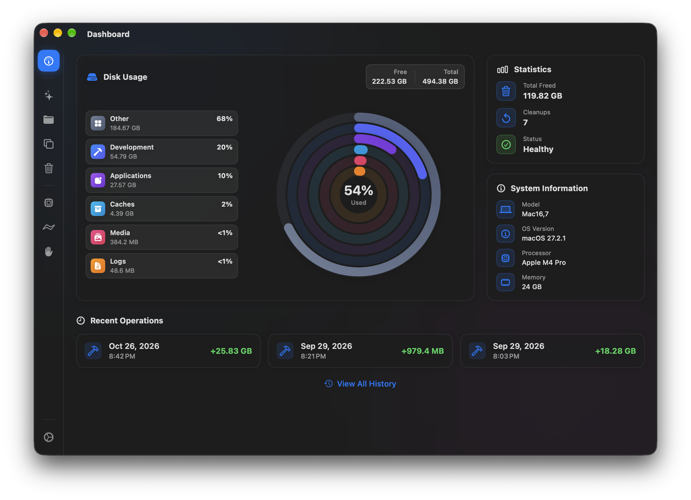
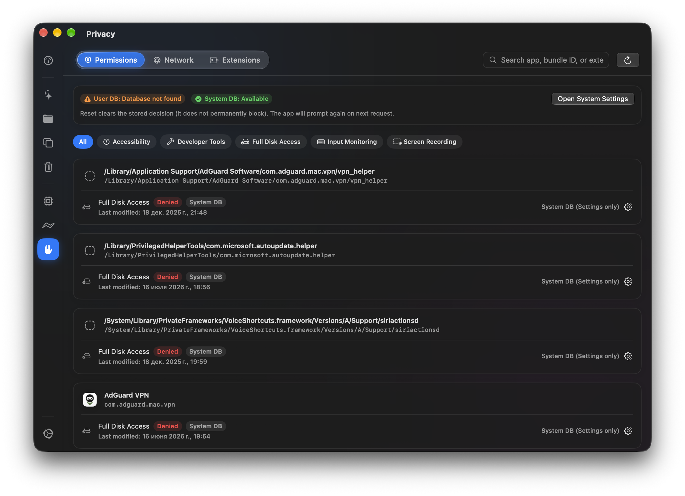
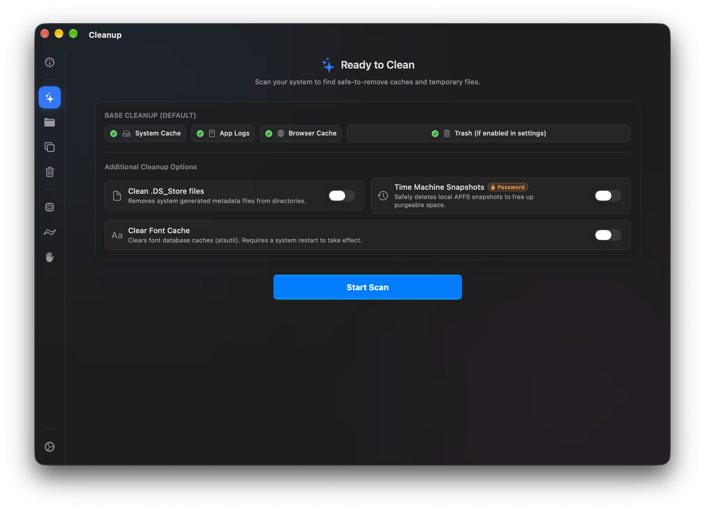

<div align="center">
  <h1 align="center">
    <br>
    <b style="font-size: 2rem">MacOS Cleaner</b>
  </h1>
  <p>
    Free, native, privacy-first cleaner and application uninstaller for macOS.<br>
    Built with Swift 6 and SwiftUI. Review everything before cleaning. Uninstalls and duplicates go to Trash.
  </p>

  <p>
    <strong>Requirements: macOS 26.0 or later. Apple Silicon only (Intel Macs are not supported).</strong>
  </p>

  <p>
    <a href="https://github.com/AlexTkDev/MacOSCleaner/releases/latest"></a>
    &nbsp;
    <a href="https://alextkdev.github.io/MacOSCleaner/"></a> &nbsp; <a href="https://github.com/AlexTkDev/MacOSCleaner"></a>
  </p>

  <p>
    <a href="https://github.com/AlexTkDev/MacOSCleaner/releases/tag/3.0.1"></a>
    <a href="https://apple.com"></a>
    <a href="https://swift.org"></a>
    <a href="https://developer.apple.com/xcode/swiftui/"></a>
    
    <a href="LICENSE"></a>
  </p>

  <p>
    <a href="#features">✨ Features</a> &nbsp;•&nbsp;
    <a href="#demo">🎬 Demo</a> &nbsp;•&nbsp;
    <a href="#build-from-source">🛠️ Build from Source</a> &nbsp;•&nbsp;
    <!-- <a href="#community">🗺️ Roadmap</a> &nbsp;•&nbsp; -->
    <a href="https://github.com/AlexTkDev/MacOSCleaner/wiki">📖 Documentation</a>
  </p>
</div>

---

<a id="safety"></a>
## 🛡️ Safety and Architecture

| Principle | Technical Implementation |
| :--- | :--- |
| **No Telemetry** | No background daemons, analytics, or remote logging. Only optional GitHub Releases update checks use the network (configurable in Settings). |
| **Safe Deletion** | Cleanup, Uninstaller, Disk Analyzer, Duplicates, and Startup Services move files to Trash (`trashItem(at:)`) by default. Permanent deletion is opt-in. |
| **Protected Paths** | Blocklists guard SIP paths, `/System`, `/Library`, `/usr`, `~/.ssh`, user documents, `.env` / `.npmrc` / `.yarnrc` / `.pypirc`, IDE folders (`.vscode`, `.idea`, `.zed`), and Finder favorites (`FavoriteItems.sfl3` / `.sfl4`). |
| **Non-Destructive Scan** | Scanning never quits apps or changes files. Cleaning waits up to 3 seconds on soft quit before force-quitting. |
| **Open Core** | Native Swift 6 with actors and structured concurrency. Core cleanup and scan rules live in readable source. |
| **On-Device AI** | File hashes and `FoundationModels` explanations run locally on your Mac with no cloud calls. |
| **Native UI** | Built with SwiftUI and macOS 26 Liquid Glass materials. No Electron or web wrappers. |

---

<a id="demo"></a>
## 🎬 Demo & Screenshots

<p align="center">
  <a href="assets/demo_video_v3.mp4">
    
  </a>
  <a href="assets/demo_video_v3.mp4">
    
  </a>
</p>

<p align="center">
  
  
</p>
<p align="center">
  
  
</p>

<p align="center">
  <a href="assets/screenshots">View high-resolution screenshots</a>
</p>

---

## 🚀 Quick Download & Install

1. **Direct Download:** Grab the latest `.dmg` from [GitHub Releases](https://github.com/AlexTkDev/MacOSCleaner/releases/latest).
2. **Mount & Drag:** Open the `.dmg` and drag `MacOSCleaner.app` into `/Applications`.
3. **If macOS says it can't verify MacOSCleaner:** On macOS 26, Gatekeeper can block the first launch (“Apple could not verify “MacOSCleaner” is free of malware”) because the app is ad-hoc signed. Only do this with the DMG from the official [GitHub Releases](https://github.com/AlexTkDev/MacOSCleaner/releases/latest) page.
   1. Move `MacOSCleaner.app` to `/Applications` (step 2).
   2. Try to open it once. Then go to **System Settings → Privacy & Security**, scroll down, click **Open Anyway**, and confirm.
   3. Or, in Terminal:

      ```bash
      xattr -dr com.apple.quarantine /Applications/MacOSCleaner.app
      ```

      > *This clears the quarantine flag macOS sets on that download. It does not change the app or system security.*

---

<a id="features"></a>
## ✨ Features

### 🧹 Smart Cleanup
- Scans **42 cleanup categories** across system caches, user logs, browser caches, **305** applications, and **105** developer toolchains (Xcode, Docker, `uv`, `mise`, Rust, Go `modcache`, Python, Node, CocoaPods).
- Detects old project build folders (checked by project markers), forgotten installers (`.dmg`, `.pkg`, `.iso`, `.zip` inspected without mounting), local AI models (Claude Code, Ollama, MLX, Hugging Face, WhisperKit), and safe Time Machine snapshot thinning (`thinlocalsnapshots`).
- Browser cleanup targets exact cache templates per bundle ID — profiles and extensions stay untouched. Review-only items are unchecked by default.
- Shows live APFS reclaimable space delta, adaptive debug logs, History (`⌘Y`), guarded Font Cache reset with confirmation, and post-cleanup restart prompts (`loginwindow` dialog).

### 🗑️ App Uninstaller & Leftovers
- Finds apps in `/Applications`, `~/Applications`, and writable `/Volumes/.../Applications` (including symlinked `.app` targets), even when Spotlight indexing is off.
- Runs a fast indexed deep scan across **30** evidence signals and **2,427** known remnant paths using bounded concurrency and low memory.
- Uses a 3-stage removal pipeline (soft quit → `launchd` bootout → Trash) with automatic Dock cleanup, inline TCC chips, Intel-only badges, and word-boundary matching to avoid false positives.
- Standalone Leftovers scanner supports admin escalation, groups `LaunchAgents`/`LaunchDaemons` under `Launch Agents`, preserves versioned plist names (such as `python3.8.plist`), and checks active Homebrew (`homebrew.mxcl.*`, `homebrew.cask.*`), MacPorts, and Nix services so CLI tools are not flagged.
- Shows a restart banner when removing system daemons, `.kext`/`.systemextension` bundles, privileged helpers, or hardware plug-ins.

### 🗂️ Duplicate Finder & Disk Space Analyzer
- **Duplicate Finder:** Master-Detail split view with a 3-stage check (size → 4 KB header SHA-256 → full SHA-256), Quick Look (`Space`), high-res photo previews, middle-truncated paths, and `Select All Duplicates` / `Deselect All`.
- **Disk Space Analyzer:** On-demand folder drill-down with breadcrumbs, APFS allocated block sizing (`totalFileAllocatedSizeKey`), hardlink deduplication, Quick Look (`Space`), and category filters (Videos, Audio, Photos, Apps, Documents, Archives).
- Both tools skip offloaded iCloud files without downloading them and only scan external volumes you pick.

### ⚙️ Processes, Startup Services & Privacy
- **Processes & Startup Services:** Live CPU/RAM monitor (safeguarding `kernel_task` and `launchd`) plus Startup Services grouping LaunchAgents, LaunchDaemons, and Login Items (`sfltool dumpbtm`) with code-signature checks (`Needs Attention` filter), disable/bootout, and removal.
- **Privacy Inspector:** Read-only TCC permission audit (`tccutil reset` for user grants), on-demand active socket snapshot for current-UID processes, and read-only browser extension audit with risk ratings across Safari, Chrome, Edge, Brave, Arc, and Firefox.
- **Live Dashboard:** Progressive disk-usage rings animate category progress and live byte counts while scanning.

###  Native macOS & Apple Intelligence
- On-device `FoundationModels` classifies items as safe, caution, or danger with streaming explanations and an Apple Intelligence storage overview in Settings.
- Siri and Shortcuts automation via **5 App Intents**, with authentication required for destructive actions.
- Native Swift 6 / SwiftUI Liquid Glass interface with a `48pt` navigation rail, keyboard shortcuts (`⌘1`–`⌘9`, `⌘Y`, `⌘,`, `⌘F`), and **14 languages** (including RTL Arabic).

<details>
<summary>Technical details</summary>

- **Uninstaller & Sizing:** single-pass `ResidualScanIndex` (`URLResourceValues` bulk snapshot), in-process `SecStaticCode` signature verification, iterative POSIX directory sizing (`fstatat` with `SF_DATALESS` and inode cycle guards).
- **System & Privacy APIs:** read-only SQLite URI (`?mode=ro&immutable=1`) for `TCC.db`, `libproc` (`proc_pidfdinfo`) socket snapshots, Chromium extension tab navigation via Apple Events (with clipboard fallback).
- **App Intents:** `GetStorageStatusIntent` (read-only), plus `.requiresAuthentication`-guarded `CleanCategoryIntent`, `CleanDeveloperCachesIntent`, `EmptyTrashIntent`, and `RunScheduledCleanupIntent`.
- **UI Containers:** `GlassEffectContainer`, `HSplitView`, `LazyVStack`.
- **Localizations (14):** English, Russian, Ukrainian, German, French, Spanish, Italian, Japanese, Simplified & Traditional Chinese, Korean, Polish, Brazilian Portuguese, Arabic.

</details>

Complete feature breakdowns live in the [MacOSCleaner Wiki](https://github.com/AlexTkDev/MacOSCleaner/wiki).

---

<a id="build-from-source"></a>
## 🛠️ Build from Source

**Prerequisites:** macOS 26.0+, Xcode 26+, [XcodeGen](https://github.com/yonaskolb/XcodeGen).

```bash
git clone https://github.com/AlexTkDev/MacOSCleaner.git
cd MacOSCleaner/MacOSCleaner
xcodegen
open MacOSCleaner.xcodeproj
```

Build and run with **⌘R**, or run tests with **⌘U**.

### Verify Release Checksums & Signature

Compare the downloaded `.dmg` checksum against the SHA-256 value published on [GitHub Releases](https://github.com/AlexTkDev/MacOSCleaner/releases):

```bash
shasum -a 256 MacOSCleaner-*.dmg
codesign -dv --verbose=4 /Applications/MacOSCleaner.app
```

## ⚠️ Known Limitations

- **Not an antivirus:** Startup checks inspect signatures, binaries, and launch paths — not malware databases.
- **TCC access:** User `TCC.db` reads require Full Disk Access; system `TCC.db` is SIP-protected. `tccutil reset` resets prior decisions rather than blocking future prompts.
- **Spotlight disabled:** App listing still works when `mdutil -a -i off` is set; `mdfind` lookups are skipped and Spotlight fields are thinner.
- **External volumes:** Auto-cleanup never targets `/Volumes` roots. Time Machine backups and OS folders (`.Spotlight-V100`, `.Trashes`) stay blocked, and read-only/ejected volume errors are reported directly.
- **Socket audit (`EPERM`):** Non-root `proc_pidfdinfo` reads only sockets owned by the current user; root daemons show `EPERM`.
- **Browser extensions:** Inspection is read-only; clicking opens the browser's management page (or copies its URL if Automation is denied).
- **On-demand only:** Nothing runs in the background between launches.

---

<a id="community"></a>
## ⭐️ Support & Community

If you find MacOS Cleaner useful, please consider giving it a ⭐️ on GitHub. It helps more users discover the project and directly supports ongoing development.

- <a href="https://github.com/AlexTkDev/MacOSCleaner/stargazers"></a> — [Star the repository](https://github.com/AlexTkDev/MacOSCleaner/stargazers) and watch releases for update notifications.
- <a href="https://github.com/AlexTkDev/MacOSCleaner/discussions"></a> — [Ask questions, propose features, and share feedback.](https://github.com/AlexTkDev/MacOSCleaner/discussions)
- <a href="https://github.com/AlexTkDev/MacOSCleaner/issues"></a> — [Report bugs or suggest rule improvements.](https://github.com/AlexTkDev/MacOSCleaner/issues)
- <a href="https://github.com/AlexTkDev/MacOSCleaner/wiki"></a> — [Architecture overview and developer guides.](https://github.com/AlexTkDev/MacOSCleaner/wiki)
- <a href="https://cursor.com/codebase/alextkdev/MacOSCleaner/tree/release"></a> — [Explore repository online and open in Cursor.](https://cursor.com/codebase/alextkdev/MacOSCleaner/tree/release)

### Our Partners
<p>
<a href="https://alternativeto.net/software/macoscleaner/about/?utm_source=badge&utm_medium=referral"></a>
<a href="https://www.saashub.com/macoscleaner?utm_source=badge&utm_campaign=badge&utm_content=macoscleaner&badge_variant=color&badge_kind=approved"></a>
<a href="https://macnative.io/apps/macoscleaner?utm_source=macnative-badge&utm_medium=referral"></a>
<a href="https://macappindex.com/apps/macos-cleaner?ref=badge" target="_blank" title="MacOS Cleaner on Mac App Index"></a>
<a href="https://macbrowse.com"></a>
<a href="https://alextkdev.github.io/MacOSCleaner/#footer-partners-heading" title="All MacOS Cleaner partners"></a>
</p>

> *Note: Contributions are subject to the project's [Contributor License Agreement (CLA)](CLA.md).*

---

## 👨‍💻 Author

<table>
  <tr>
    <td width="72" align="center" valign="middle">
      <a href="https://github.com/AlexTkDev">
        
      </a>
    </td>
    <td>
      <strong>Aleksandr (AlexTkDev)</strong><br>
      <a href="https://github.com/AlexTkDev"></a>
      <a href="https://orcid.org/0009-0002-8907-5406"></a>
      <a href="https://ko-fi.com/alextkdev"></a>
      <a href="DONATE.md"></a>
    </td>
  </tr>
</table>

> Citation reference: [`CITATION.cff`](CITATION.cff)

---

## 📄 License

Dual-licensed:
- **[GNU GPLv3 + Commons Clause v1.0 (Non-Commercial)](LICENSE)** — free solely for personal non-commercial use, academic/educational projects, testing, and upstream contributions. Commercial resale, paid services, and commercial re-licensing are prohibited.
- **Commercial License / Permission** — required before any commercial use by a legal entity or an individual (including internal business use, enterprise deployment, client work, paid services, or proprietary distribution). Contact the author via [GitHub (@AlexTkDev)](https://github.com/AlexTkDev) or [LinkedIn](https://www.linkedin.com/in/aleksandrtk/) for licensing inquiries.

> **Trademark Notice**: The license does not grant permission to use the project names ("MacOSCleaner", "MacOS Cleaner"), logos, icons, or branding in modified versions or third-party redistributions.
